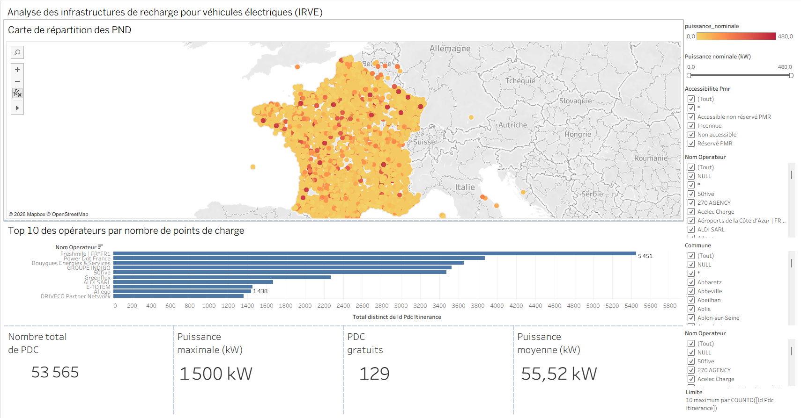
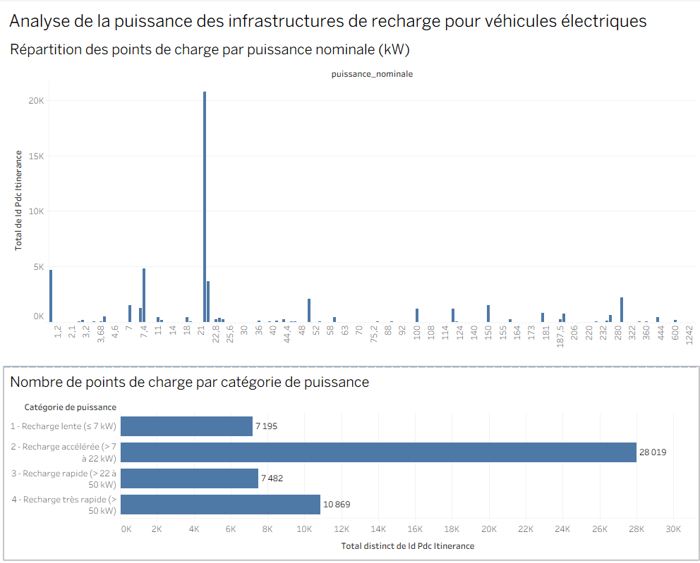
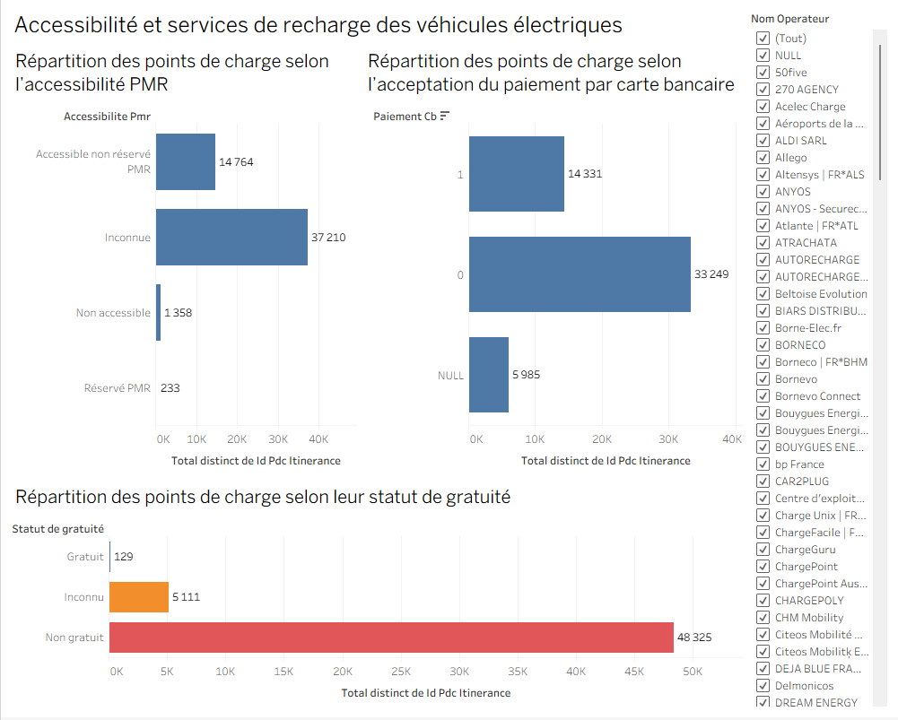
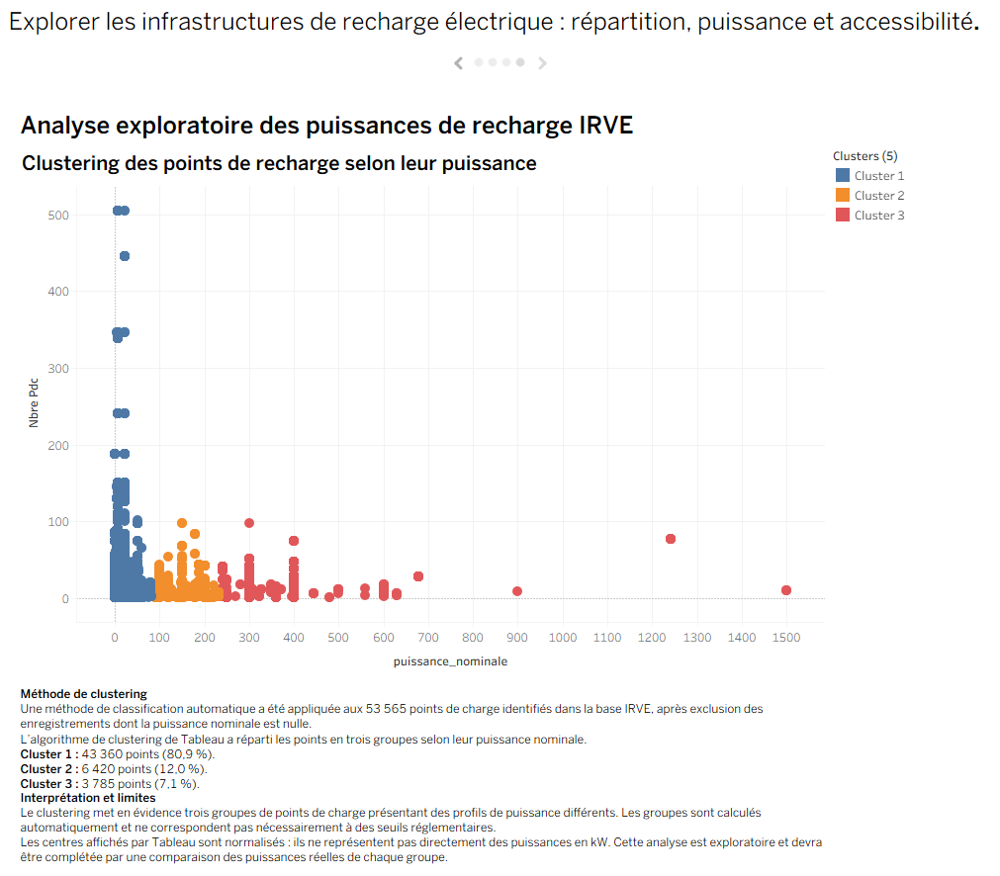

# Analyse des infrastructures de recharge pour véhicules électriques (IRVE)

## Présentation du projet

Ce projet consiste à préparer, analyser et visualiser les données relatives aux infrastructures de recharge pour véhicules électriques (IRVE).

L’objectif est de transformer un jeu de données brut en une base analytique exploitable, puis de concevoir des visualisations interactives permettant d’explorer la répartition des points de charge, leurs puissances nominales et les services proposés.

## Objectifs

- Nettoyer et structurer les données avec MySQL.
- Identifier et traiter les doublons à partir des identifiants fiables des points de charge.
- Repérer les valeurs manquantes et les déclarations contradictoires.
- Construire une table dédiée à l’analyse.
- Concevoir des tableaux de bord interactifs avec Tableau Desktop.
- Présenter les résultats et les limites des données de manière transparente.

## Technologies utilisées

- **MySQL** : préparation, nettoyage, dédoublonnage et contrôles qualité.
- **Tableau Desktop** : analyse exploratoire, indicateurs clés et visualisations interactives.
- **GitHub** : versionnement et documentation du projet.

## Méthodologie

### 1. Préparation des données

La table brute `irve_brut` est conservée afin de préserver les données d’origine. Une table analytique distincte, `irve_clean`, est utilisée pour les analyses.

Le traitement comprend notamment :
- l’identification des points de charge à partir de `id_pdc_itinerance` ;
- la sélection d’une déclaration de référence parmi les occurrences d’un même identifiant fiable ;
- la prise en compte de la complétude et des dates disponibles pour sélectionner cette déclaration ;
- le repérage des contradictions et des valeurs manquantes ;
- la normalisation de certaines valeurs pour faciliter l’analyse.

Les déclarations sans identifiant fiable ne sont pas intégrées à l’analyse principale.

### 2. Analyse et visualisation

Trois axes d’analyse ont été développés dans Tableau :

**Vue générale des infrastructures**
- Nombre de points de charge distincts.
- Répartition géographique.
- Principaux opérateurs.
- Indicateurs de puissance et de gratuité déclarée.

**Analyse des puissances**
- Distribution des puissances nominales.
- Comparaison des catégories de puissance.
- Identification des valeurs extrêmes.

**Accessibilité et services**
- Accessibilité aux personnes à mobilité réduite (PMR).
- Disponibilité déclarée du paiement par carte bancaire.
- Statut de gratuité : gratuit, non gratuit ou inconnu.

## Principaux résultats

Le traitement a permis de construire une table analytique contenant **53 565 points de charge distincts identifiés par un identifiant fiable**.

Les indicateurs calculés dans Tableau comprennent notamment :
- le nombre de points de charge distincts ;
- la puissance nominale moyenne ;
- la puissance nominale maximale ;
- le nombre de points déclarés gratuits ;
- le nombre de points pour lesquels le paiement par carte bancaire est déclaré disponible.

Les résultats doivent être interprétés en tenant compte de la qualité et de la complétude des déclarations.

## Limites de l'analyse

Certaines informations sont manquantes ou contradictoires. Une donnée inconnue ne doit pas être interprétée comme une réponse négative.

La sélection d’une déclaration de référence ne permet pas nécessairement de résoudre toutes les contradictions. Les résultats décrivent les données disponibles et non une garantie d’exhaustivité de l’ensemble des infrastructures.

## Organisation du dépôt

- `sql/` : scripts SQL de préparation et de contrôle des données.
- `tableau/` : classeur Tableau et fichiers associés, selon les possibilités de partage.
- `images/` : captures des tableaux de bord et de l’histoire Tableau.
- `documentation/` : dictionnaire des données et règles de traitement.

## Perspectives d'amélioration

- Améliorer la complétude des informations géographiques.
- Approfondir les contrôles de cohérence.
- Documenter les règles de nettoyage et les choix analytiques.
- Actualiser les données pour suivre l'évolution des infrastructures.

---
## Aperçu des visualisations

### 1. Vue générale des infrastructures

### 2. Analyse des puissances

### 3. Accessibilité et services

## Analyse exploratoire par clustering

### Objectif

Une analyse exploratoire par clustering a été réalisée dans Tableau afin de regrouper les points de charge IRVE selon leur puissance nominale. L’objectif est d’identifier différents profils de puissance et de mieux caractériser les équipements présents dans la base.

### Méthode

- Analyse réalisée à partir de la table nettoyée `irve_clean`.
- Exclusion des points dont la puissance nominale est nulle pour cette analyse.
- Utilisation de l’algorithme de clustering intégré à Tableau.
- Création de trois groupes à partir de la puissance nominale.
- Visualisation des groupes dans un graphique de dispersion et un tableau de bord dédié.

### Résultats

L’analyse porte sur 53 565 points de charge et distingue trois groupes :

| Groupe | Nombre de points | Part du total |
|---|---:|---:|
| Cluster 1 | 43 360 | 80,9 % |
| Cluster 2 | 6 420 | 12,0 % |
| Cluster 3 | 3 785 | 7,1 % |
| **Total** | **53 565** | **100 %** |

Le premier groupe est largement majoritaire. Les deux autres groupes regroupent des proportions plus faibles de points de charge.

### Interprétation et limites

Le clustering permet de faire ressortir des groupes présentant des profils de puissance différents. Ces groupes sont produits automatiquement par l’algorithme et ne correspondent pas nécessairement à des seuils réglementaires ou à des catégories officielles de recharge.

Les résultats doivent être interprétés comme une analyse exploratoire. Les valeurs centrales affichées par Tableau sont normalisées et ne correspondent pas directement à des puissances exprimées en kilowatts.

### Outils utilisés

- MySQL et Navicat pour la préparation et l’exploration des données.
- Tableau Desktop pour la visualisation et le clustering.
- GitHub pour la documentation et le suivi du projet.
*Projet de data analyse réalisé avec MySQL et Tableau Desktop.*

### Visualisation des clusters

